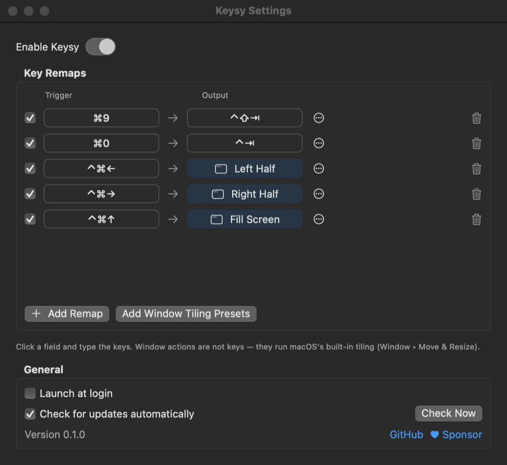

<p align="center">
  
</p>

<h1 align="center">Keysy</h1>

<p align="center">A tiny macOS menu bar app: remap keys, move windows with global shortcuts, and change macOS's own shortcuts (screenshots, input sources).</p>

<p align="center">
  <a href="https://github.com/jojonki/Keysy/releases/latest"></a>
  
  <a href="LICENSE"></a>
  <a href="https://github.com/sponsors/jojonki"></a>
</p>

<p align="center">
  
</p>

## Features

The sidebar has two groups: **Shortcuts** (by what the shortcut does) and **Keysy** (app settings).

### Shortcuts ▸ Custom Shortcuts
- **Any number of shortcuts** that type other keys, each with its own on/off switch
- **Record by typing** — click a field and press the keys
- Example: ⌘9 → ⌃⇧⇥ (previous tab), ⌘0 → ⌃⇥ (next tab)
- Starts empty; nothing is remapped until you add it

### Shortcuts ▸ Window Layouts
Global shortcuts that move the front window — in **every app** (including ones without a Window menu),
effective immediately. Nothing is assigned until you set it.

| Section  | Commands |
|----------|----------|
| Halves   | Left, Right, Top, Bottom |
| Quarters | Top Left, Top Right, Bottom Left, Bottom Right |
| Arrange  | Left & Right, Right & Left, Top & Bottom, Bottom & Top (front window + the one behind it) |
| General  | Fill Screen, Center, Restore Previous Size |

Keysy moves the window itself through the Accessibility API.

> **Replacing Snappy:** set Left Half → ⌃⌘←, Right Half → ⌃⌘→, Fill Screen → ⌃⌘↑, then quit
> [Snappy](https://github.com/jojonki/Snappy).

### Shortcuts ▸ macOS Features
Change macOS's own system-wide shortcuts — only the ones you pick:

| Group          | Features |
|----------------|----------|
| Screenshots    | Save/copy screen, save/copy selected area, Screenshot & recording options |
| Input Sources  | Select previous / next input source |

Keysy writes your shortcut into macOS's settings (the same place System Settings ▸ Keyboard ▸
Keyboard Shortcuts uses), so they work even when Keysy isn't running. Each row shows macOS's
official shortcut with a **Default / Custom / Off** badge; ↩︎ resets that row to the official one.

### Keysy ▸ Import & Export
Export all your settings (Custom Shortcuts, Window Layouts, and the macOS Features you changed) to a
JSON file and import it on another Mac. Importing replaces the current settings after asking.

### Also
- Launch at login, automatic update check from GitHub Releases
- Compact menu bar menu: counts per section, click to open that page
- Links to this repository and to sponsorship from the menu

## Install

Download `Keysy.dmg` from [Releases](https://github.com/jojonki/Keysy/releases), drag Keysy to Applications,
then grant **Accessibility** permission when prompted
(System Settings → Privacy & Security → Accessibility). Custom Shortcuts and Window Layouts need it;
macOS Features don't.

## Build

```sh
./build.sh                            # builds build/Keysy.app, .zip and .dmg
VERSION=0.1.0 ./build.sh              # set the version
NOTARY_PROFILE=<profile> ./build.sh   # also notarize
```

The app icon is generated from `Resources/icon.png`.
Releases are published as `vX.Y.Z` tags with `Keysy.zip` attached; the in-app updater installs that zip.

## Support

If Keysy is useful to you, please consider [sponsoring me on GitHub](https://github.com/sponsors/jojonki) ♥
You can also reach it from the menu bar: **Support the Developer ♥**.

Bug reports and feature requests are welcome in [Issues](https://github.com/jojonki/Keysy/issues).

## License

[MIT](LICENSE) © Junki Ohmura
